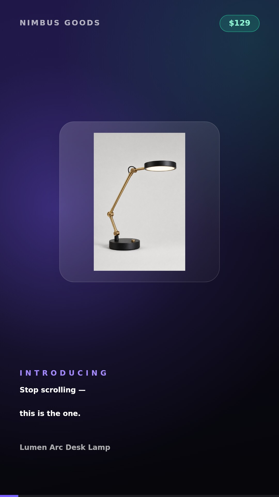
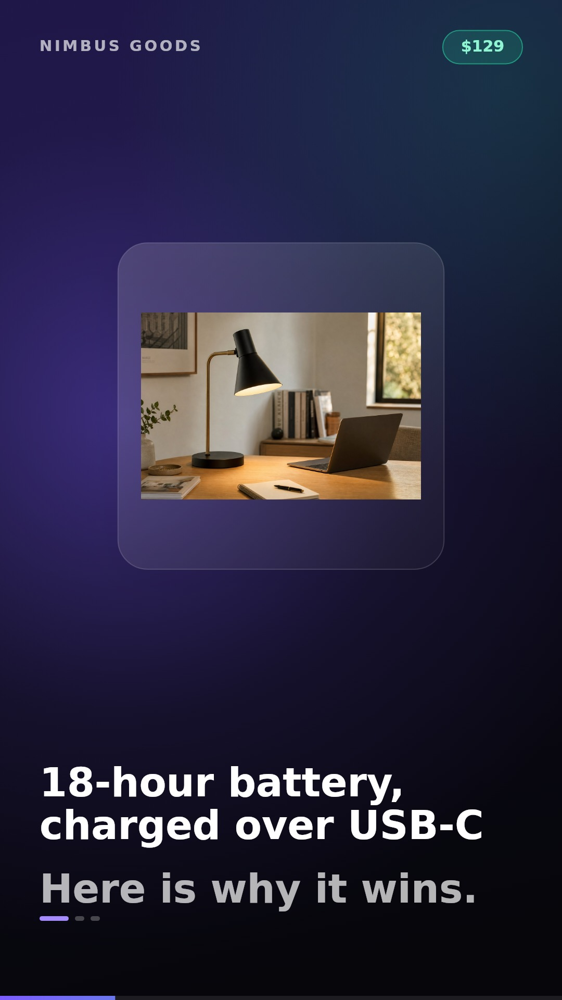
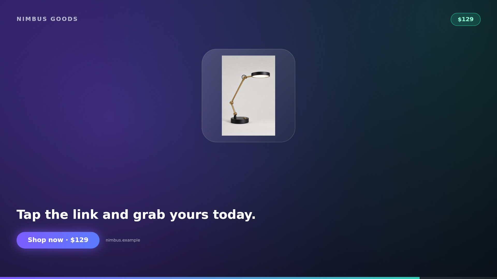

# ⚡ url-to-ad-gen

Turn **any product URL** into a **ready-to-post video ad** — scrape the product page, write the ad copy, then render and download the video, all from the browser.

No Puppeteer, no headless Chrome, no server-side renderer, no upload.



---

## Why this exists

This is an independent, re-implemented clone of the excellent
[Rakshath66/adgen](https://github.com/Rakshath66/adgen) (MIT). That project proved the idea —
paste a product link, get a video ad — but it depends on Puppeteer + Remotion + an OpenAI key,
which makes it awkward to run in a sandbox, a container, or on a cheap host.

This version keeps the product idea and the four-step flow, and changes what needed changing:

| | adgen (upstream) | url-to-ad-gen (this repo) |
|---|---|---|
| Scraping | Puppeteer (needs Chrome, breaks on serverless) | `fetch` + `cheerio` on JSON-LD / Open Graph / microdata |
| Supported stores | Amazon + Shopify only | any store that publishes structured product data |
| Ad copy | Requires an OpenAI key | OpenAI if `OPENAI_API_KEY` is set, otherwise a built-in copywriter engine |
| Video | Remotion server render (needs Chromium) | canvas renderer + `MediaRecorder`, runs in the browser |
| Output | Server writes files to `downloads/` | browser download, nothing stored server-side |
| Aspect ratios | 1920×1080 | 9:16, 1:1, 16:9 |
| Extras | — | live editing of the copy, image picker, caption + hashtags, pluggable OpenAI model |

Everything else — the URL → product → copy → video flow, the Zustand store, the preview-then-export
pattern — follows the original architecture.

---

## Preview

| Hook (9:16) | Benefit scene (9:16) | CTA (16:9) |
|---|---|---|
|  |  |  |

---

## How it works

```text
URL ──▶ /api/scrape ──▶ product {title, price, features, images…}
                          │
                          ▼
                      /api/generate-ad ──▶ ad copy {hook, scenes[], cta, caption, hashtags}
                          │
                          ▼
              AdPlayer (canvas preview) ──▶ useExport ──▶ MP4 / WebM download
```

1. **Scrape** — `lib/scrape.ts` fetches the page and reads, in order of preference:
   - `application/ld+json` → `Product` (`name`, `description`, `brand`, `offers.price`, `image[]`)
   - `og:*` / `product:*` meta tags (`og:title`, `og:description`, `og:image`, `product:price:amount`)
   - microdata and common Shopify / WooCommerce / Amazon DOM selectors as a fallback
   - Thumbnails are upscaled (`_SL1500_`, `_1200x1200`) and de-duplicated.

2. **Write the copy** — `lib/ad-copy.ts`
   - With `OPENAI_API_KEY`: a JSON-mode chat completion produces the hook, 4–5 scenes, CTA, caption and hashtags.
   - Without a key (or if the call fails): a deterministic template engine builds the same structure from
     the product's features, price and brand. **The app is fully usable with zero API keys.**
   - Scenes are editable in the UI before you export.

3. **Render & export** — `lib/render-frame.ts` paints one frame at any `elapsedMs` with Canvas 2D.
   - The preview and the exporter call the *same* function, so what you see is what you get.
   - `canvas.captureStream(30)` + `MediaRecorder` encode the file in-browser.
   - Chrome/Edge → `.mp4` (H.264), Firefox → `.webm` (VP9).
   - Product images are loaded through `/api/image-proxy`, so third-party CDNs with blocked hotlinking
     or no CORS headers can't taint the canvas or break the export.

---

## Getting started

```bash
npm install
cp .env.example .env.local   # optional: add OPENAI_API_KEY
npm run dev                  # http://localhost:3000
```

Requires Node 18+ and a modern browser (Chrome/Edge recommended for MP4 output).

### Try it without a real store

The repo ships a demo product page so you can exercise the whole pipeline offline:

```
http://localhost:3000/demo/index.html
```

Paste that into the URL field. It contains real JSON-LD + Open Graph metadata, so the scraper
gets title, brand, price, description, six features and three images — exactly like a live shop.
(Other sandboxed/unreachable hosts are reported with a friendly error instead of a stack trace.)

### Environment variables

| Variable | Required | Purpose |
|---|---|---|
| `OPENAI_API_KEY` | no | Enables LLM ad copy. Without it the template engine is used. |
| `OPENAI_MODEL` | no | Overrides the default `gpt-4o-mini`. |

---

## Project structure

```text
url-to-ad-gen/
├── app/
│   ├── page.tsx                   # 4-step wizard shell
│   ├── layout.tsx / globals.css   # theme
│   └── api/
│       ├── scrape/route.ts        # URL -> product data
│       ├── generate-ad/route.ts   # product -> ad copy (AI or template)
│       └── image-proxy/route.ts   # CORS-safe product image proxy
├── components/
│   ├── UrlForm.tsx                # step 1
│   ├── ProductCard.tsx            # step 2 (edit main image)
│   ├── ScriptPanel.tsx            # step 3 (edit copy, preview, pick ratio)
│   ├── ExportPanel.tsx            # step 4 (record, progress, download)
│   ├── AdPlayer.tsx  AdStage.tsx  # canvas player
│   └── useExport.ts               # MediaRecorder pipeline
├── lib/
│   ├── scrape.ts                  # cheerio scraper
│   ├── ad-copy.ts                 # OpenAI + template copywriter
│   ├── render-frame.ts            # the ad renderer (single source of truth)
│   ├── store.ts                   # zustand store
│   └── types.ts
├── public/demo/                   # offline demo product page + images
└── docs/                          # rendered preview frames
```

---

## Design notes

- **Why canvas instead of DOM capture?** Snapshotting DOM at 30 fps is slow and drops frames.
  A canvas `drawFrame(ctx, {elapsedMs})` renderer is deterministic, renders a 1080×1920 frame in
  ~5–10 ms, and is trivially reusable for server-side rendering later.
- **Why no Remotion?** Remotion is great, but it needs Chromium at render time. The renderer here is
  a pure function, so it can be dropped into Remotion (`<Composition>` calling `drawFrame` per frame)
  or a worker if you want server exports — see the roadmap.
- **Why proxy images?** Without it, `captureStream` throws a `SecurityError` the moment a product
  image comes from a CDN that doesn't send CORS headers. That is most of them.

---

## Roadmap

- [ ] Server-side MP4 export with Remotion (reuse `drawFrame`)
- [ ] AI voice-over via TTS + audio mixing into the recorded stream
- [ ] Background music tracks
- [ ] Multiple templates (bold, minimal, price-led)
- [ ] Save/share ad projects (Postgres + auth)
- [ ] Bulk mode: CSV of URLs → a folder of ads

---

## Credits & license

- Inspired by [Rakshath66/adgen](https://github.com/Rakshath66/adgen) — MIT © Rakshath U Shetty.
  This is a clean re-implementation, not a fork; no upstream source files were copied.
- MIT © url-to-ad-gen contributors. See [LICENSE](LICENSE).
